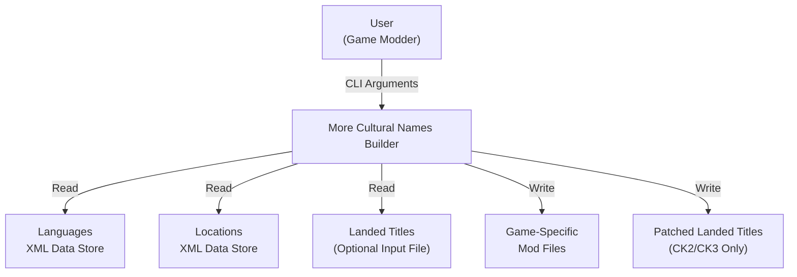
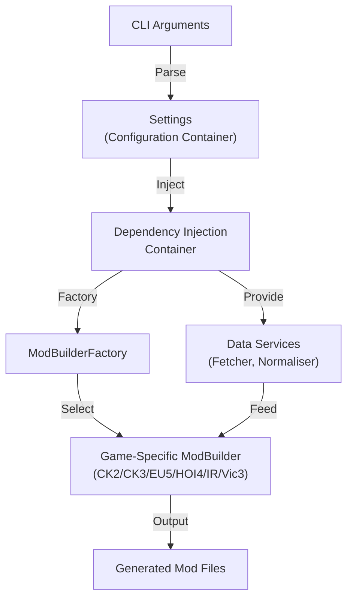
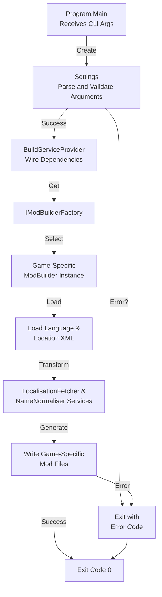
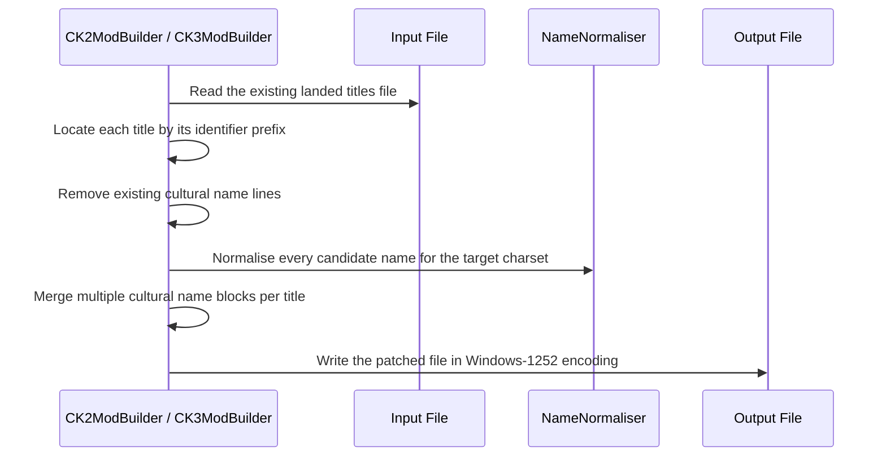
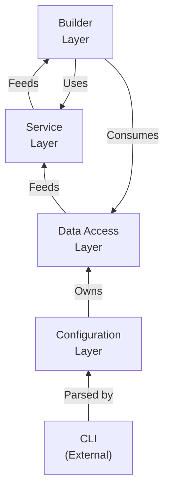

# More Cultural Names Builder Architecture

This document describes the current architecture of the More Cultural Names Builder, a console-based mod generation pipeline that reads localisation data and generates game-specific mod files for multiple game engines.

## 📑 Table of Contents

- [Purpose](#purpose)
- [System Context](#system-context)
- [Architectural Style](#architectural-style)
- [Runtime Process](#runtime-process)
- [Components](#components)
- [Architectural Areas](#architectural-areas)
  - [Configuration](#configuration)
  - [Data Access](#data-access)
  - [Service Layer](#service-layer)
  - [Mod Builders](#mod-builders)
- [Data Architecture](#data-architecture)
- [Interfaces and Integrations](#interfaces-and-integrations)
- [Key Processes](#key-processes)
  - [Landed Titles Patching](#landed-titles-patching)
- [Name Normalisation](#name-normalisation)
- [Cultural Name Block Merging](#cultural-name-block-merging)
- [Cross-Cutting Concerns](#cross-cutting-concerns)
  - [Security and Privacy](#security-and-privacy)
  - [Error Handling](#error-handling)
  - [Observability](#observability)
  - [Configuration](#configuration-1)
  - [Concurrency and Resource Use](#concurrency-and-resource-use)
- [Dependency Direction and Rules](#dependency-direction-and-rules)
- [External Dependencies](#external-dependencies)
- [Deployment and Operations](#deployment-and-operations)
- [Compatibility Contracts](#compatibility-contracts)
- [Testing and Verification](#testing-and-verification)
- [Design Constraints](#design-constraints)
- [Extension Points](#extension-points)
  - [Adding a Game Target](#adding-a-game-target)
  - [Adding a Data Object](#adding-a-data-object)
  - [Adding a CLI Argument](#adding-a-cli-argument)
- [Source Map](#source-map)
- [Related Documentation](#related-documentation)

## 🎯 Purpose

The More Cultural Names Builder is a command-line tool that transforms linguistic and geographic data into game-specific mod files. It reads XML data stores for languages and locations, applies localisation and name normalisation, and generates output files compatible with Crusader Kings II, Crusader Kings III, Europa Universalis V, Hearts of Iron IV, Imperator: Rome, and Victoria 3. The architecture prioritises independent game-specific generation logic, reusable data transformation services, and fail-fast configuration validation.

## 🌐 System Context



The principal external boundaries are:

- **Data Stores:** The application reads two mandatory XML files (languages, locations) and an optional landed-titles file, maintaining no connection once data is loaded into memory.
- **Game Mod Files:** Output is written to a designated directory; the application owns file creation but not mod registration or game installation.
- **Operator Shell:** The application receives command-line arguments and exits with status codes; it does not maintain a runtime daemon.

## 🏗️ Architectural Style

More Cultural Names Builder implements a **console pipeline architecture** with these characteristics:

- **Stateless Processing:** Configuration is loaded once at startup from command-line arguments; application state does not accumulate during the build phase.
- **Factory-Based Polymorphism:** A factory selector determines the appropriate game-specific mod builder at runtime based on the `--game` argument.
- **Layered Dependency Injection:** Microsoft.Extensions.DependencyInjection wires services, repositories, and builders; loose coupling between layers is enforced via interfaces.
- **Fail-Fast Validation:** Configuration parsing and validation occur before the build phase, ensuring all required inputs are present before processing begins.



The principal architecture boundaries are:

- **Configuration Layer:** Parses and validates command-line arguments; raises errors for absent required values.
- **Data Layer:** Reads XML repositories; provides immutable entity objects to services.
- **Service Layer:** Transforms and normalises localisation and name data; independent of game logic.
- **Builder Layer:** Game-specific implementations of `IModBuilder`; each builder consumes service outputs and writes mod-format files.

## 🔄 Runtime Process



The principal runtime sequence is:

1. **Argument Parsing:** `Settings` constructor parses all command-line arguments and validates required fields; raises an exception if validation fails.
2. **Dependency Injection Setup:** `BuildServiceProvider()` instantiates the DI container and registers all singletons (settings, repositories, services, factory).
3. **Builder Selection:** `IModBuilderFactory.GetModBuilder(settings)` instantiates the correct game-specific builder based on `settings.Mod.GameId`.
4. **Build Execution:** The selected builder loads data from XML repositories, applies data transformation services, and writes output files.
5. **Process Exit:** Application terminates with status code 0 on success or non-zero on unhandled exception.

## 🧩 Components

| Component | Responsibility | Principal Dependencies | Lifetime or Ownership |
|-----------|----------------|------------------------|-----------------------|
| `Program` | Parses arguments, composes the service provider, and invokes the build | `Settings`, `IModBuilderFactory` via the service provider | One instance for the process |
| `Settings` | Holds the parsed CLI configuration and its sub-settings | `NuciCLI.Arguments` | Singleton for the process |
| `XmlRepository<T>` | Materialises data objects from a caller-supplied XML file | `NuciDAL` | Singleton per registered data object type |
| `LocalisationFetcher` | Resolves cultural names per location and language with fallback chains | Repositories, `NameNormaliser` output models | Singleton for the process |
| `NameNormaliser` | Converts names to the character set each game engine supports | `NuciText.Conversion` | Singleton for the process |
| `ModBuilderFactory` | Selects the game-specific builder from the `--game` argument | `IModBuilder` implementations | Singleton for the process |
| `ModBuilder` and subclasses | Load data and write the mod files for one game | Repositories, `ILocalisationFetcher`, `INameNormaliser` | One instance per build |

## 🗂️ Architectural Areas

### Configuration

**Paths:**
- `MoreCulturalNamesBuilder/Configuration/`

**Responsibilities:**
- Parse command-line arguments using `NuciCLI.Arguments.ArgumentParser`.
- Validate required and optional argument presence and format.
- Expose normalised configuration via `Settings`, `InputSettings`, `ModSettings`, and `OutputSettings`.
- Support legacy alias arguments (`--output`/`--out`, `--version`/`--ver`) for backward compatibility with existing mod build scripts.

**Boundary rules:**
- Configuration is instantiated once at application startup and exposes mutable auto-properties; callers must not modify it during a build.
- No I/O operations occur during Settings instantiation (parsing only).
- Invalid arguments cause an exception; error recovery is the caller's responsibility.

### Data Access

**Paths:**
- `MoreCulturalNamesBuilder/DataAccess/DataObjects/`

**Responsibilities:**
- Define XML data objects: [LanguageDataObject](MoreCulturalNamesBuilder/DataAccess/DataObjects/LanguageDataObject.cs), [LocationDataObject](MoreCulturalNamesBuilder/DataAccess/DataObjects/LocationDataObject.cs), [NameDataObject](MoreCulturalNamesBuilder/DataAccess/DataObjects/NameDataObject.cs), [LanguageCodeDataObject](MoreCulturalNamesBuilder/DataAccess/DataObjects/LanguageCodeDataObject.cs), and [GameIdDataObject](MoreCulturalNamesBuilder/DataAccess/DataObjects/GameIdDataObject.cs).
- Serve as data transfer objects between XML repositories and service layer.
- Maintain no business logic; entities are passive data containers.

**Boundary rules:**
- Entities are instantiated by `NuciDAL` XML repositories; configuration layer does not instantiate entities directly.
- Entities are read-only; mutations occur only in mapping and service layers.

### Service Layer

**Paths:**
- [Service](MoreCulturalNamesBuilder/Service/)
- [Mapping](MoreCulturalNamesBuilder/Service/Mapping/)

**Responsibilities:**
- `LocalisationFetcher`: Retrieves localisation data for a given location and language, normalising keys for consistency.
- `NameNormaliser`: Applies linguistic rules to normalise names (e.g., handling special characters, phonetic transformations).
- Mapping services convert between entity and model objects (see Data Architecture).

**Boundary rules:**
- Services are stateless; all dependencies are injected and immutable.
- Services depend only on data entities and interfaces; they must not reference builder implementations.

### Mod Builders

**Paths:**
- [Mod Builders](MoreCulturalNamesBuilder/Service/ModBuilders/)

**Responsibilities:**
- `IModBuilder`: Interface defining the `Build()` contract.
- `ModBuilder`: Base class providing common file generation logic for all games (shared localisation file format).
- Game-specific builders (`CK2ModBuilder`, `CK3ModBuilder`, `EuropaUniversalis5ModBuilder`, `HOI4ModBuilder`, `ImperatorRomeModBuilder`, `Victoria3ModBuilder`): Extend `ModBuilder` and implement game-specific file output (patched `landed_titles` files in the CK series, localisation files per language, province-name data files for IR, dynamic state and hub name effects for Victoria 3, and language-suffixed location-name localisation for Europa Universalis V).
- `IModBuilderFactory`: Selects the appropriate builder at runtime.

**Boundary rules:**
- All builders implement `IModBuilder` and inherit from `ModBuilder`.
- Builders depend on service layer (`ILocalisationFetcher`, `INameNormaliser`) but not on each other.
- Game-specific builders are instantiated only once during the build phase.

## 💾 Data Architecture

The application processes two principal data flows:

1. **Localisation Data Flow:**
   - **Source:** Language and Location XML files (external, user-provided).
    - **Load:** Parsed into language and location data object collections via `NuciDAL` XML repositories.
   - **Transform:** `LocalisationFetcher` maps entities to application models and retrieves localised place names.
   - **Persist:** Game-specific builders write localisation strings to game mod format files (e.g., the patched `landed_titles` file and per-language localisation files).

2. **Name Normalisation Flow:**
   - **Source:** Location names from XML.
   - **Transform:** `NameNormaliser` applies linguistic rules to normalise diacritics and special characters.
   - **Persist:** Normalised names are included in generated mod files.

| Data or Store | Owner | Representation and Storage | Lifecycle or Consistency |
|---|---|---|---|
| Language and location data object collections | `IFileRepository<T>` (NuciDAL) | Loaded entirely into memory during startup; discarded on exit. | Mutable XML data containers; callers must not mutate them during a build. |
| `Language`, `Location`, `Localisation` models | Service layer | Derived from entities; intermediate representation for builder consumption. | Created on-demand during build phase; no persistent caching. |
| Generated mod files | `ModBuilder` | Game-specific format (e.g., CK3 localisation files, HOI4 custom format). | Written once to `OutputSettings.OutputPath`; no subsequent updates within a single build. |

## 🔌 Interfaces and Integrations

| Interface or Integration | Direction | Contract | Owner | Failure Semantics |
|---|---|---|---|---|
| CLI Arguments | Inbound | Command-line string array, parsed by `ArgumentParser`. | Configuration layer | Unrecognised or missing required arguments raise an exception; application terminates. |
| XML Data Stores | Inbound | Language and Location XML files at paths specified by `--lang` and `--loc`. | Data access layer | File-not-found or XML parse errors raise an exception; application terminates. |
| Landed Titles File (Optional) | Inbound/Outbound | CK2/CK3 landed-titles format; read, patched, and written to output directory. | `CK2ModBuilder`, `CK3ModBuilder` | File read failure: exception. Invalid format: silent skip or partial output (determined by builder). |
| Game Mod Output | Outbound | Game-specific format (e.g., `.txt` for CK3 localisation, `.yml` for Europa Universalis V and Victoria 3, custom formats for HOI4/IR). | Builders | File write errors raise an exception; application terminates. |

## 🔀 Key Processes

### Landed Titles Patching



The builder preserves every unrelated line of the source file and rewrites only the cultural name blocks. Merging operates on direct children of a title block, so a block owned by a nested county or barony stays with that nested title instead of being hoisted into its parent. The width of the recognised title identifier class is supplied by the builder (`ekdcb` for CK2, `hekdcb` for CK3 with the hegemony tier), so extending the recognised tiers is a single override.

## ⚙️ Name Normalisation

`NameNormaliser` converts Unicode names to the limited character sets each engine accepts. Shared preprocessing removes zero-width characters, directionality marks, and invisible characters, normalises apostrophes and dashes, resolves floating diacritics into precomposed characters, and applies common transliterations. Each game then applies its own character map and final regular-expression adjustments, and every per-game method caches its results in a `ConcurrentDictionary<string, string>`.

The replacement loop exits as soon as no replaceable character is found, which avoids allocating a `StringBuilder` for the common case of an already-conforming name.

## ⚙️ Cultural Name Block Merging

`CK3CulturalNameBlockMerger` merges multiple `cultural_names` blocks belonging to the same title into a single block and deduplicates `name_list_` entries by key. Block boundaries are located with a single-pass brace counter. The content is returned unchanged when no title requires merging, and only blocks that are direct children of the title are considered, so nested titles keep their own blocks.

## 🧵 Cross-Cutting Concerns

### Security and Privacy

The application runs locally, performs no network access, receives no credentials, and stores no personal data. Trust boundaries are limited to the operator shell, the caller-supplied XML data stores, and the output directory; the data stores are read as XML, and the output path is used verbatim, so the operator is responsible for supplying trustworthy inputs and a writable directory.

### Error Handling

Failures originate in argument parsing, XML loading, name normalisation, and file writing. Argument and repository failures surface as exceptions from `Settings` and `XmlRepository<T>` respectively, the factory raises `NotImplementedException` for an unsupported game, and all of them propagate to `Program.Main`, terminating the process with a non-zero status code. No degradation, retry, or fallback path exists, and a failed build leaves any files already written in place.

### Observability

Progress is written to standard output, timing is reported for the data-retrieving and file-generation phases, and errors reach standard error through the unhandled exception path. No log files, metrics, traces, or health checks are produced; structured diagnostics are limited to the platform exception output.

### Configuration

| Configuration Area | Source | Responsibility | Supersede or Secret Policy |
|--------------------|--------|----------------|---------------------------|
| Input data stores | `--lang`, `--loc` command-line arguments | Paths of the language and location XML repositories | Required; no alternative source |
| Landed titles input | `--landed-titles` command-line argument | Optional source file patched in place for CK2 and CK3 | Absent for Europa Universalis V, HOI4, and Imperator: Rome |
| Mod identity | `--id`, `--name`, `--version`/`--ver` command-line arguments | Descriptor identity written into the generated mod | Required |
| Mod dependency | `--dependency`/`--dep` command-line argument | Optional mod identifier recorded in the descriptor | Optional |
| Game selection | `--game`, `--game-version` command-line arguments | Target builder and declared game version | Required; unknown values raise `NotImplementedException` |
| Output | `--output`/`--out`, `--landed-titles-name`, `--verbose` command-line arguments | Output directory, output file name, and verbose comments | Required output directory; no secrets are involved |

### Concurrency and Resource Use

Builders parallelise localisation retrieval with `Parallel.ForEach` over the location game identifiers and collect results in `ConcurrentDictionary` instances before materialising deterministic dictionaries. The CK3 canonical localisation index is built once per build and reused. All language and location data is held in memory for the duration of the build, and the process handles exactly one build per invocation, so no resource pool, backpressure mechanism, or capacity limit is applied beyond the memory required by the data set.

## 🧭 Dependency Direction and Rules

The dependency graph enforces a strict layering:



The principal dependency rules are:

- Configuration depends only on NuciCLI and built-in .NET types.
- Data access (`NuciDAL` repositories) is instantiated by the DI container; no other layers instantiate repositories.
- Service layer depends on data entities and interfaces; no dependency on builders or configuration.
- Builders depend on services and data layer; builders do not depend on each other.
- **Prohibited:** No circular dependencies; no downward dependencies (builder → service → builder).
- **Prohibited:** Configuration layer must not be referenced by service, builder, or data access layers. Builders must not instantiate other builders.

## 📦 External Dependencies

| Dependency | Responsibility | Integration Boundary | Architectural Consequence |
|------------|----------------|----------------------|---------------------------|
| `NuciDAL` | XML repository implementation and entity base type | `Program.BuildServiceProvider()`, `DataAccess/DataObjects/` | Supplies the repository and entity contracts; the production project declares no project references |
| `NuciCLI.Arguments` | Command-line parsing | `Configuration/Settings.cs` | Constrains argument registration and error messages |
| `NuciText.Conversion` | Character-set conversion | `Service/NameNormaliser.cs` | Provides the Windows-1252 conversion used for CK output |
| `NuciExtensions` | Shared extension helpers | Throughout the production project | Reduces local utility code |
| `Microsoft.Extensions.DependencyInjection` | Service composition | `Program.BuildServiceProvider()` | Centralises the composition root and singleton lifetimes |
| `Microsoft.Extensions.Configuration` and its binder and JSON providers | Configuration primitives | Available to the production project | Declared dependencies; the pipeline is configured through CLI arguments rather than configuration files |

## 🚀 Deployment and Operations

More Cultural Names Builder is a stateless, single-invocation console application. Each execution is independent; no server, persistent state, or background processes are maintained.

| Concern | Current Design | Architectural Consequence |
|---|---|---|
| **Process Topology** | Single-threaded console process; one build per invocation. | No concurrency primitives required; simplicity aids debugging and portability. |
| **Execution Model** | Stateless pipeline; all input loaded at startup, output written at completion. | No partial results or resumable builds; failed builds must be re-executed from scratch. |
| **Persistent State** | None. Output files are independent; no shared state or locks. | Multiple builds can run in parallel on the same system without coordination. |
| **Exit Semantics** | Status code 0 on success; non-zero on exception. | Shell scripts can chain builds or implement conditional logic based on exit code. |
| **Output Directory** | User-specified via `--output` or `--out`. | Caller must ensure directory exists and is writable; application does not create intermediate directories. |
| **Scaling** | Not applicable. | Scaling is achieved by running multiple independent processes, not by changing the application runtime. |

## 🛡️ Compatibility Contracts

| Contract | Owner | Invariant | Verification | Change Policy |
|----------|-------|-----------|--------------|---------------|
| CLI argument names and aliases | `Configuration/Settings.cs` | `--lang`, `--loc`, `--output`/`--out`, `--id`, `--name`, `--version`/`--ver`, `--game`, `--game-version`, `--landed-titles`, `--landed-titles-name`, `--dependency`/`--dep`, `--verbose` remain accepted | `SettingsTests` | Renaming or removing an argument is a breaking change for existing mod build scripts |
| Game identifiers | `ModBuilderFactory.GetModBuilder()` | `CK2`, `CK3`, `EU5`/`EuropaUniversalis5`, `HOI4`, `IR`, and `Vic3` select their builders | `ModBuilderFactoryTests` | Additional identifiers are additive; existing identifiers must keep resolving |
| Input XML schema | `DataAccess/DataObjects/` | Element and attribute names including `Language`, `Location`, `GameId`, `Name`, `iso-639-1` remain mapped | `DataObjectSerialisationTests` | Schema changes are breaking for callers who supply data stores |
| Output layout | Game builders | The mod descriptor, launcher metadata, localisation, landed titles, and province name paths within the mod directory remain stable | Builder tests that build against temporary directories | Changes require a coordinated update to the mod packaging scripts |
| Landed titles format | `CK2ModBuilder`, `CK3ModBuilder`, `CK3CulturalNameBlockMerger` | Unrelated lines survive patching, and cultural name blocks remain valid for the game | `CK2ModBuilderTests`, `CK3ModBuilderTests` | Format changes follow the supported game versions |
| Name normalisation output | `NameNormaliser` | Each game method returns names within the supported character set for its target | `NameNormaliserTests`, `NameNormaliserEdgeCaseTests` | Changes alter every generated name and require regeneration of existing mods |

## ✅ Testing and Verification

The project includes three test suites that verify:

- **Configuration parsing:** `SettingsTests` validate argument parsing, required field detection, canonical and alias precedence, blank alias fallback, and verbose flag parsing.
- **Name normalisation:** `NameNormaliserTests` verify linguistic transformation rules (special character handling, diacritics).
- **Mappings and services:** mapping tests, model key tests, and `LocalisationFetcherTests` cover entity-to-model conversion, identity contracts, and fallback resolution.
- **Builder output:** every game builder is exercised end to end against temporary directories, asserting descriptor, localisation, landed titles, and data-file content, including Victoria 3 hub suffix recognition, hub-only cultures, and foreign identifier handling.
- **End-to-end pipeline:** `MoreCulturalNamesBuilder.IntegrationTests` invokes the entry point with real XML data stores and landed titles files, asserting the exact content, encoding, and file inventory of every generated mod file, plus every configuration and data-loading failure mode.
- **Structural conventions:** `MoreCulturalNamesBuilder.ArchitectureTests` enforces dependency direction and acyclicity, project conventions, and source conventions, including the rule that builders must not depend on the configuration layer, that only `ModBuilderFactory` constructs builders, that `TestPaths` stays synchronised with the `TestData` fixtures, and that each source and semantic convention is proven against inline snippets by `ConventionDetectorTests`.

Execute the principal automated verification with:

```bash
dotnet test
```

**Test Boundaries:**
- Unit tests cover the configuration and service layers, and build every game builder end to end against temporary directories.
- Integration tests run the complete pipeline against repository fixtures but do not load the generated mods in the games.
- Data access layer is not mocked; tests use real XML deserialisation.
- The architecture test suite requires a repository checkout and fails when expected sources or selectors are absent.

**Material Coverage Gaps:**
- No game compatibility validation: generated mod file syntax is asserted only against the builder's own expectations, never against the games.
- No performance benchmarks or regression guards on build duration.
- No verification against the production language and location data sets, which are maintained outside this repository.

## ⚠️ Design Constraints

- **No Directory Creation:** The application does not create intermediate directories; output directory must exist and be writable prior to execution.
- **Single Invocation Per Process:** Each process handles exactly one build; no daemon or persistent server mode.
- **Configuration Ownership:** Settings expose mutable auto-properties; every build uses the same parsed configuration and presumes callers do not modify it concurrently.
- **In-Memory Data Loading:** All localisation data is loaded into memory during startup; no streaming or pagination of large datasets.
- **No Transaction Support:** Failed builds do not roll back partial output files; idempotency is caller responsibility.
- **Game Alias Requirement:** The `--game` argument requires an exact string match (CK2, CK3, EU5, HOI4, IR); no fuzzy matching or abbreviations.
- **Europa Universalis V Localisation Placement:** The EU5 builder must emit its localisation into `main_menu/localization/<language>/replace/`, because vanilla location names are loaded from `main_menu` and only the `replace` folder reliably overrides existing keys.
- **Alias Argument Handling:** `--output`/`--out` and `--version`/`--ver` pairs must both be provided or validation fails, even when only one pair is used; this is a validation gap introduced to support legacy scripts.

## 🔧 Extension Points

### Adding a Game Target

1. Create a builder in `MoreCulturalNamesBuilder/Service/ModBuilders/` that derives from `ModBuilder`, or from `CK2ModBuilder` when the landed titles format is shared.
2. Add the game identifier case to `ModBuilderFactory.GetModBuilder()`.
3. Add the game-specific character map and method to `INameNormaliser` and `NameNormaliser` when the engine needs its own character set.
4. Include unit tests covering the descriptor, data files, localisation content, and failure handling.

The new builder must inherit the `IModBuilder` contract, avoid referencing sibling builders, and keep the recognised landed-title identifier class aligned with the tiers the game supports.

### Adding a Data Object

1. Define the data object in `MoreCulturalNamesBuilder/DataAccess/DataObjects/` with the XML serialisation attributes.
2. Add the mapping extension in `MoreCulturalNamesBuilder/Service/Mapping/`.
3. Register the repository in `Program.BuildServiceProvider()`.
4. Extend `LocalisationFetcher` and the affected builders when the new data participates in name resolution or output.

### Adding a CLI Argument

1. Register the argument in the `Settings` constructor.
2. Add the property to `InputSettings`, `ModSettings`, or `OutputSettings`, with resolution logic for any alias.
3. Extend `SettingsTestFactory` and `SettingsTests` to cover the new argument.

Extension points inherit the existing conventions: services remain stateless, data objects remain passive, and builders remain independent of one another.

## 🗺️ Source Map

| Area | Path |
|---|---|
| Configuration parsing and argument validation | `MoreCulturalNamesBuilder/Configuration/` |
| Domain entity definitions | `MoreCulturalNamesBuilder/DataAccess/DataObjects/` |
| Data transformation services and mapping | [Service](MoreCulturalNamesBuilder/Service/) |
| Game-specific mod builders | [Mod Builders](MoreCulturalNamesBuilder/Service/ModBuilders/) |
| Unit test suite | `MoreCulturalNamesBuilder.UnitTests/` |
| Integration test suite | `MoreCulturalNamesBuilder.IntegrationTests/` |
| Dependency injection setup and entry point | `MoreCulturalNamesBuilder/Program.cs` |

## 📚 Related Documentation

- [README.md](./README.md) – Usage, installation, and capabilities overview.
